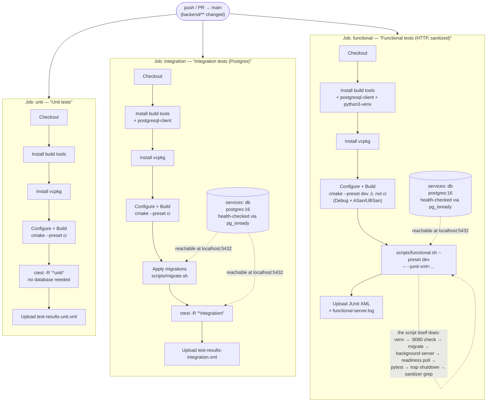
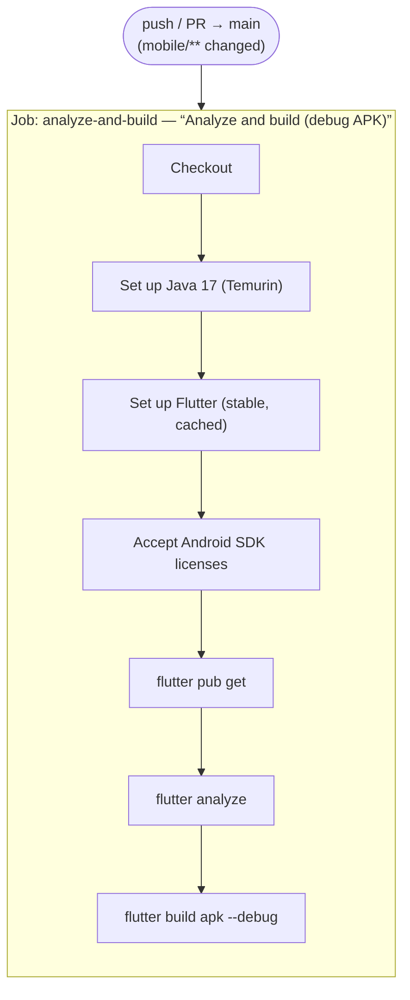

# CI pipelines

Two independent GitHub Actions workflows, one per stack. Each has a `paths:` filter so a
mobile-only commit never triggers the backend pipeline and vice versa.

> **Keep this in sync.** Whenever `backend-ci.yml` or `mobile-ci.yml` changes shape (a new
> job, a new step, a different trigger), update the matching diagram below in the same
> commit. See the `backend` / `frontend` subagent instructions, which carry this as a
> standing rule.

---

## Backend — `backend-ci.yml`

Triggers on `push`/`pull_request` to `main` when `backend/**` or the workflow file itself
changes. Three independent jobs run in parallel (no `needs:` between any of them — see the
"Job split rationale" comment in the workflow file for why) so one tier's failure can't hide
another's.

The two Catch2 jobs build the same two binaries (`tests_unit`, `tests_integration`); what
differs is which one's tests each runs. `backend/tests/CMakeLists.txt` tags every CTest name
with a prefix per binary, so a single `-R` pattern selects one tier without touching the
other. `functional` can't work that way — it isn't a CTest target at all:

| Job | Runs | Covers |
|---|---|---|
| `unit` | `ctest -R '^unit/'` | `src/domain/` — pure logic, no I/O |
| `integration` | `ctest -R '^integration/'` | `src/repository/` + `ConnectionPool` — real SQL against the `services: db` sidecar |
| `functional` | `scripts/functional.sh --preset dev` | `src/handlers/` + `src/app.cpp` — real HTTP against a real server process |

All three share the vcpkg binary cache (`VCPKG_BINARY_SOURCES`) — building three times costs
seconds once warm, not the ~3 minute cold build.

**Two things about `functional` that look like mistakes but aren't:**

- **It builds `--preset dev`, not `ci`.** `ci` is Release with sanitizers off. This is the
  only tier that runs the server as a real process under real concurrent load, which is
  exactly where ASan/UBSan pay off — and on `ci` the sanitizer-report grep inside
  `functional.sh` could never fire, making it dead code. The suite runs in about a second,
  so the overhead is free. See `PROJECT_PLAN.md` §10 (2026-10-12).
- **It has no "Apply migrations" step.** `functional.sh` runs `scripts/migrate.sh` itself, so
  adding one would duplicate it.

Still missing from this workflow: a **lint/format job**. `clang-format` runs only locally as
the first step of `scripts/dev.sh`, so a commit that bypasses the script can land
unformatted — §8's "Lint in parallel, not as a prerequisite" is not yet built.

---

## Mobile — `mobile-ci.yml`

Triggers on `push`/`pull_request` to `main` when `mobile/**` or the workflow file itself
changes. A single job: no database, no server — just static analysis and a from-scratch
build to prove the app compiles on a clean machine.

`flutter analyze` is the fast, valuable check — type errors, null-safety violations, unused
imports, deprecated API usage, all without a device or emulator. `flutter build apk --debug`
catches what analysis can't (Gradle misconfiguration, missing manifest entries, broken native
plugin bindings) by actually compiling the app end-to-end. `flutter test` isn't run in CI
yet — `mobile/atenciosamente_app/test/widget_test.dart` is currently just a placeholder; add
a test step here once real widget tests exist.
